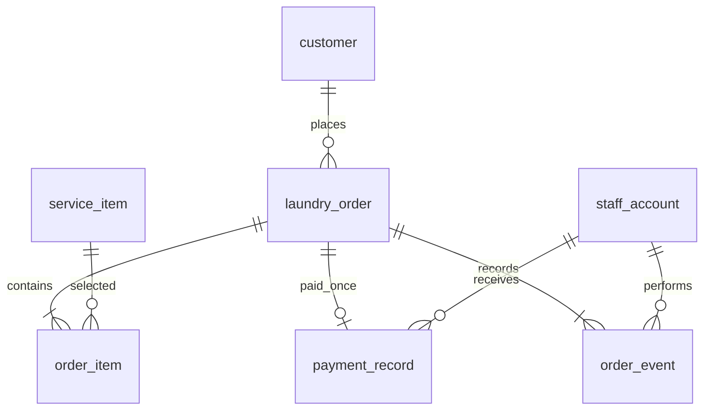

# 一期数据模型与字段说明 V0.1

日期：2026-11-19。数据库：用户已选择本机现有 MySQL。范围依据：`phase1-order-walkthrough.md` 中的普通到店、逐件收衣、整单流转、线下一次付清方案。具体收费、取消等业务规则仍沿用该推演的草案性质。

2026-11-19更新：已创建xiyi_dev开发库并执行V001，数据库层验证已通过。脚本位置：`database/mysql/V001__create_core_tables.sql`。

## 1. 统一约定

- 主键 `id` 为 BIGINT 自增，业务订单号 `order_no` 单独保存；主键不是顾客查询凭证。
- 金额全部以人民币“分”存储，例如148元为14800；应用精确转换，不用浮点计算。服务端对输入范围和求和溢出做检查。本草案只接受正价订单，不含赠送或零价。
- DATETIME(3) 保存应用提供的 UTC 时间，界面按 Asia/Shanghai 展示；预计取衣是门店本地 DATE，不是时间戳。日实收查询先把门店当天起止时间转为 UTC 区间。
- 可修改实体有 `created_at`、`updated_at`，由服务端写入；收款与操作历史追加保存，不开放普通修改删除接口。
- 员工、客户、项目、订单有 `version` 并发版本。衣物修改依赖所属订单版本，不另设独立版本。
- 字符串非空、手机号格式、密码强度等仍需后端验证；NOT NULL 不等于禁止空字符串。
- 每件衣物一行，每行只关联一个洗护项目，不设数量字段；服务当前按件计价。将来按重量、面积或多服务计费时另行设计迁移。
- 业务表之间使用外键，默认限制关联记录删除，不启用级联删除。员工与项目停用后保留历史引用。

## 2. 表关系

每张有效订单至少一件衣物、至少一条开单事件由业务事务保证，外键本身只保证已有明细能找到订单。收衣、交付、取消人员也引用员工表。

## 3. 员工账号 staff_account

| 字段 | 类型/可空 | 含义 |
| --- | --- | --- |
| id | BIGINT，必填 | 主键 |
| username | VARCHAR(64)，必填且唯一 | 登录名，应用限定ASCII并统一小写 |
| password_hash | VARCHAR(255)，必填 | 安全密码哈希；不保存明文，不预置通用密码 |
| display_name | VARCHAR(50)，必填 | 员工姓名 |
| role_code | VARCHAR(16)，必填 | MANAGER店长、STAFF店员；具体操作权限由后端定义 |
| enabled | TINYINT，默认1 | 1启用、0停用；后续请求需检查有效身份 |
| version / created_at / updated_at | 必填 | 并发版本、创建及修改时间 |

固定两类角色，不建设动态权限配置表；角色代码仅标识角色，不自动赋予数据库权限。店长初始化与防止误停用全部管理账号在后端实现。

## 4. 客户 customer

| 字段 | 类型/可空 | 含义 |
| --- | --- | --- |
| id | BIGINT，必填 | 客户主键 |
| name | VARCHAR(50)，必填 | 姓名 |
| phone | VARCHAR(32)，必填 | 联系电话，用于检索，不设唯一约束 |
| remark | VARCHAR(500)，可空 | 客户备注 |
| version / created_at / updated_at | 必填 | 并发与时间 |

手机号按文本保存；新增前检索核对，同号允许区分不同客户。客户不是登录账号，不能凭手机号读取他人的全部订单。

## 5. 洗护项目 service_item

| 字段 | 类型/可空 | 含义 |
| --- | --- | --- |
| id | BIGINT，必填 | 项目主键 |
| code | VARCHAR(32)，必填且唯一 | 稳定项目编码，如 COAT_CLEAN |
| name | VARCHAR(100)，必填 | 项目名称 |
| standard_price_cents | BIGINT，必填且大于0 | 当前每件标准价，单位分 |
| enabled | TINYINT，默认1 | 新开单只选启用项目；停用不影响历史 |
| version / created_at / updated_at | 必填 | 并发与时间 |

改单时未改变项目的原有衣物保留成交价；新增衣物或改选项目取当时有效价格。此规则是当前草案建议，避免每次改单把整单自动按新价格重算。

## 6. 订单 laundry_order

| 字段 | 类型/可空 | 含义 |
| --- | --- | --- |
| id / order_no | BIGINT / VARCHAR(40)，必填 | 主键与唯一业务订单号，禁止用行数加1生成订单号 |
| customer_id | BIGINT，必填 | 客户外键 |
| contact_name / contact_phone | VARCHAR(50/32)，必填 | 开单时联系人快照，客户改资料不自动回写历史 |
| status | VARCHAR(16)，必填 | RECEIVED待洗、WASHING洗护中、READY待取、COMPLETED已完成、CANCELLED已取消 |
| total_amount_cents | BIGINT，必填且大于0 | 本单应收合计，由服务端计算 |
| expected_pickup_date | DATE，必填 | 预计取衣日期 |
| note | VARCHAR(1000)，可空 | 收衣及洗护要求 |
| received_by / received_at | BIGINT / DATETIME(3)，必填 | 收衣员工和时间；柜台开单即确认收衣 |
| washing_started_at / ready_at | DATETIME(3)，可空 | 开始和完成洗护时间 |
| delivered_by / delivered_at | BIGINT / DATETIME(3)，可空 | 交付员工与时间，确认交付时一起填写 |
| cancelled_by / cancelled_at / cancel_reason | BIGINT / DATETIME(3) / VARCHAR(500)，可空 | 取消时一起填写，原因不能为空 |
| create_request_key | VARCHAR(64)，必填且唯一 | 客户端为一次开单动作生成的重试标识 |
| create_request_hash | CHAR(64)，必填 | 服务端计算的规范化开单请求摘要；后续改单不修改此值 |
| version / created_at / updated_at | 必填 | 并发与时间 |

本轮只实现门店已收衣订单，因此不加入待收衣状态和假顾客账号。原型的顾客预下单若正式接入，再扩展来源、账号归属、可空收衣字段和状态。

同一开单重试键必须对应原请求及原经办人；先鉴权再查重，键相同但内容不同返回冲突，不返回其他人的业务数据。摘要不是密码，不能代替认证。

## 7. 衣物明细 order_item

| 字段 | 类型/可空 | 含义 |
| --- | --- | --- |
| id / order_id | BIGINT，必填 | 明细主键与订单外键 |
| item_no | INT，必填且大于0 | 本单内衣物序号，和 order_id 联合唯一 |
| garment_type / color | VARCHAR(50)，必填 | 实物类别和颜色，区别同项目的衣物 |
| condition_note | VARCHAR(500)，必填 | 检查情况；无瑕疵也明确记录“无明显瑕疵”，不自动替员工确认 |
| service_item_id | BIGINT，必填 | 项目外键 |
| service_name_snapshot | VARCHAR(100)，必填 | 成交项目名快照 |
| unit_price_cents | BIGINT，必填且大于0 | 本件成交价，保留历史 |
| created_at / updated_at | DATETIME(3)，必填 | 创建及修改时间 |

不存重复的数量1或行金额。衣物件数由明细数计算，整单金额为本单明细价格之和。允许的改单若删除明细，应在同一事务先取得旧快照，再写入带原因的 EDITED 事件；不允许通过通用删除接口绕过订单规则。

## 8. 收款 payment_record

| 字段 | 类型/可空 | 含义 |
| --- | --- | --- |
| id / order_id | BIGINT，必填 | 主键、订单外键；order_id唯一，一期每单最多一笔实际收款 |
| amount_cents | BIGINT，必填且大于0 | 实收金额，必须等于交易时订单应收 |
| method | VARCHAR(24)，必填 | CASH现金、OFFLINE_ELECTRONIC线下电子支付 |
| paid_at | DATETIME(3)，必填 | 实际确认收款时间，一期由服务端即时记录，不开放补录日期 |
| received_by | BIGINT，必填 | 收款员工，来自登录身份 |
| request_key / request_hash | VARCHAR(64) / CHAR(64)，必填 | 唯一重试键及规范化请求摘要 |
| created_at | DATETIME(3)，必填 | 记录建立时间 |

不存在收款记录即未付款；有效记录金额即已收金额。接口派生付款状态，不在订单上存可独立改写的 paid 标记。表内只存已确认线下收款，不存网关支付尝试。

取消或改单与收款必须竞争同一个订单锁，避免一边收款一边降低金额或取消。相同请求重试返回已有结果；不同请求键再次收同一订单拒绝重复。二期分次收款时需迁移订单唯一约束并重设计余额校验，不提前放开。

## 9. 操作记录 order_event

| 字段 | 类型/可空 | 含义 |
| --- | --- | --- |
| id / order_id | BIGINT，必填 | 事件主键、订单外键 |
| actor_id / actor_name_snapshot | BIGINT / VARCHAR(50)，必填 | 员工引用及当时姓名 |
| event_type | VARCHAR(24)，必填 | 收衣、开始/完成洗护、收款、交付、改单、取消、异常备注 |
| occurred_at | DATETIME(3)，必填 | 操作时间 |
| reason | VARCHAR(1000)，可空 | 改单、取消和异常记录必须由后端要求填写 |
| before_data / after_data | JSON，可空 | 相关业务字段快照，受控白名单，禁止整份请求及密码令牌写入 |

收款事件引用对应收款ID、金额和方式；改单保存必要前后信息；状态事件保存前后状态。该表不代替收款台账，也不是失败登录或完整安全日志系统。

## 10. 数据库负责什么，后端负责什么

| 数据库约束 | 后端事务及校验 |
| --- | --- |
| 主键、外键、订单号/账号/项目编码唯一 | 当前身份、角色、账号启停、登录名规范化 |
| 金额为正、枚举值合法 | 明细非空、价格来自有效项目、应收等于明细合计 |
| 单内衣物编号唯一 | 逐件核对、瑕疵描述、修改前后追溯 |
| 每单最多一条收款及请求键唯一 | 足额收款、请求内容一致、取消/改单/收款互斥 |
| 完成/取消的部分字段一致性 | 全部时间和经办字段一致、合法状态顺序、已付款才能交付 |

建议所有订单写操作在事务中先锁定该订单，检查前置状态/版本，再写业务与事件，最后增加订单版本。开单在单一事务建立订单、明细和事件；唯一键冲突需回滚并在有效事务中查重。任何一步失败均不返回业务成功。前端携带版本以识别用户基于旧内容提交的修改。

## 11. 索引与查询

- 客户手机号、姓名用于检索；子串模糊查询不保证用到普通索引，先控制分页与查询范围。
- 订单号唯一索引；订单按客户及创建时间、状态及创建时间、联系手机和创建时间检索。
- 收款按 paid_at 查询实收；不要先把衣物明细和收款多行直接连接再求和，避免重复计入收入。
- 操作记录按订单、时间和ID展示稳定顺序。
- 常用查询遇到实际性能问题再依据执行计划调整索引，不提前建设统计汇总表。

## 12. 二期扩展边界

顾客登录及预下单、会员及额度、退款、分次收款、单件任务、多服务计价均需独立业务规则和迁移。当前不加入无意义的预留列或表；以后通过版本化迁移扩展。已付款取消在本草案中仍被阻止，若一期必须支持退款应先调整范围。

## 13. 验证状态

已在MySQL 8.0.44的xiyi_dev库创建七张表，8项正常断言和10项异常约束检查通过，验证事务已回滚、七表均为空。详见 `docs/04-组件说明/database-mysql/execution-2026-11-19.md`。后端权限、状态规则、并发、重启及备份恢复尚未验证，不能把建表完成视为完整业务系统可用。
